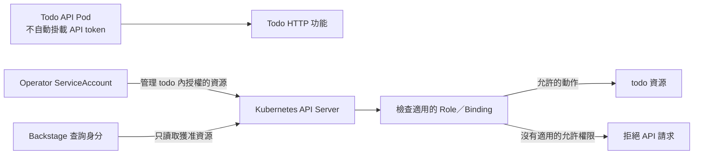

# Day 27 - Kubernetes RBAC 與 Namespace 能隔離什麼

前一篇讓開發者從 Backstage 查詢服務。查詢後端需要讀取 Kubernetes，但不該因為能顯示 Pod 就取得修改 Deployment 的能力。同樣地，提供 Todo 功能的 API、維持資源的 Operator，以及同步設定的 Argo CD，都需要不同權限。

這篇先把 Kubernetes 的 API 權限邊界說清楚。現有 Operator 與 Backstage 查詢身分已有有限的授權，不代表整個平台完成了多團隊隔離。

## Namespace 與 RBAC 各負責哪一部分？

Namespace 為多數資源提供名稱與管理範圍，讓兩個環境能各有一個 `todo-api`。但把服務分到不同 Namespace，不會自動擋住跨 Namespace 的 API 存取，也不會阻止 Pod 透過網路連到別的 Service。

角色型存取控制（Role-Based Access Control，RBAC）決定的是：某個身分能對哪種 Kubernetes 資源執行哪些動作。`Role` 定義 Namespace 內的規則，`RoleBinding` 將規則授予使用者、群組或 `ServiceAccount`。只有 Role 而沒有對應的 binding，服務不會因此取得權限。

`ClusterRole` 可以提供可重用的規則。用 `RoleBinding` 授予 Namespace 範圍的動作，仍只作用於該 Namespace；`ClusterRoleBinding` 則可授予叢集範圍的權限。RBAC 的允許權限會累加，沒有一條 deny 可以抵銷別的 binding 已授予的能力，所以要一起檢查所有適用的授權。

## 不需要 Kubernetes API 的服務，就不先給權限

Todo API 提供 HTTP 功能，不需要自己建立或查詢 Kubernetes 資源。Operator 產生的 Pod 已設定不自動掛載 ServiceAccount token；這和 Operator 本身需要呼叫 API，是兩件事。

| 身分 | 所需能力 | 不應順便取得的能力 |
| --- | --- | --- |
| Todo API | 執行應用程式 | 列出 Secret、修改工作負載 |
| Operator | 讀取 CR、管理受管資源、回寫 `status` | 任意 Namespace 或叢集資源的管理權 |
| Argo CD | 同步核准的設定 | 任意 repository、目的地或資源的寫入權 |
| Backstage 查詢後端 | 讀取服務相關資源 | 部署寫入權 |
| Backstage 模板後端 | 提出 Git PR | 因提出部署需求就取得 Kubernetes 憑證 |

目前 Operator 的 Role 限定在 `todo`，但其中的 Deployment 寫入權仍涵蓋整個 Namespace。程式會檢查 owner reference，RBAC 卻不會因此只允許它修改 `todo-api`；不能把程式保護說成 Kubernetes 已有逐服務隔離。

下圖將工作負載、資源管理與查詢分開。API Server 依實際使用的身分檢查授權，不會拿 Catalog 的 `owner` 當成權限。

## 權限、網路與資源預算不能混在一起

RBAC 不決定 BFF 能不能透過 HTTP 呼叫 Todo API，也不限制 container 的 CPU 或記憶體。網路範圍要另外評估 `NetworkPolicy`，資源預算可用 `ResourceQuota` 等機制處理。共用 Namespace 或 Node 時，這些邊界更不能省略。

驗證權限要同時看允許與拒絕。這次 Operator 的授權檢查允許修改 `todo` 的 Deployment，但不允許修改 `default` 的 Deployment，也不允許讀取 `todo` 的 Secret；這是該身分與目前 binding 的結果，不是所有團隊都已隔離的證明。

增加授權前，先確認服務真的需要哪個 API 動作，以及使用的是哪份憑證。下一篇再看另一道邊界：身分有權建立資源，不代表送進來的內容符合平台政策。
