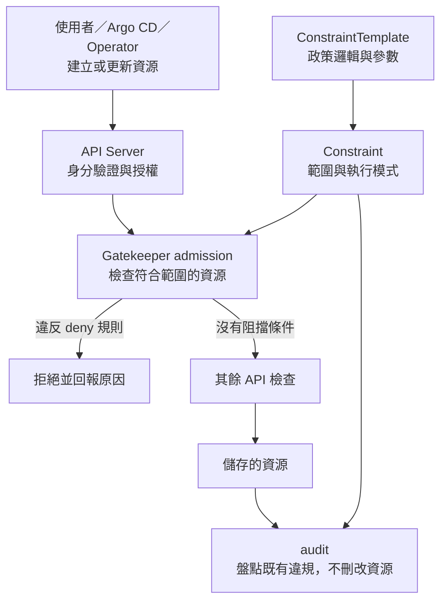

# Day 28 - 用 Gatekeeper 理解資源政策與風險設定

RBAC 可以允許 Operator 在 `todo` 建立 Deployment，卻不會判斷它是否用了特權容器或未核准的 image。這些資料可能型別正確、提交者也有權限，仍不符合平台要求。

政策即程式碼（Policy as Code）把要求寫成能版本管理、審查與測試的規則。Open Policy Agent（OPA）提供政策評估引擎，Gatekeeper 則把評估接到 Kubernetes 的准入控制（Admission Control）。本系列沒有這組 Gatekeeper 政策與拒絕結果，以下介紹機制與導入時要確認的事。

## 規則邏輯與適用範圍分開寫

建立或更新資源的請求通過身分驗證與授權後，還會經過 admission。Gatekeeper 的 validating webhook 可以檢查比對範圍內的資源，依政策決定是否拒絕。

`ConstraintTemplate` 定義邏輯、參數結構與 constraint 類型；`Constraint` 是實際使用的規則，指定檢查哪些資源、Namespace、參數與執行模式。只有 Template，或 Constraint 沒選到目標，都不能宣稱已經保護該資源。

下面將新請求的檢查和既有資源盤點分開。這是政策設計，不是已部署的流程。

## 三種風險，要給三種能修正的回饋

| 檢查情境 | 應指出什麼 | 規則還沒有保證什麼 |
| --- | --- | --- |
| 缺少 CPU／memory limits | 哪個 container 缺了哪個欄位 | 額度合理、效能足夠；CPU limit 可能造成 throttling，memory 超限可能被 OOM 終止 |
| `privileged: true` | 哪個 container 使用特權，是否需要例外審查 | 非特權 container 就沒有其他安全風險 |
| image 來源或版本不合規 | 核准的 repository 邊界與是否要求 digest | 字串格式符合就代表由受信任 CI 建置或已獲環境核准 |

檢查 image 不能只用「包含 `ghcr.io/yrw9281`」這種字串判斷。要比對完整 repository 邊界；即使要求 digest，仍需要 CI 來源與 Git review 的證據。

檢查範圍也要涵蓋需要的 container 類型，包括一般 container 與 init container。只檢查第一個 container，或只看 Deployment 卻忽略其他工作負載，會留下缺口。若只在 Pod admission 拒絕，Deployment 可能已建立，要從 ReplicaSet 事件才能看見 Pod 建立失敗。

## 先盤點，再決定是否拒絕

audit 會找出已存在的違規資源，不會替它們修好設定。`dryrun` 讓政策不阻擋請求，可透過 audit 盤點；`warn` 回傳警告但不阻擋；`deny` 則拒絕違規的新建／更新請求。Gatekeeper 的 `dryrun` 不等於 Kubernetes server-side dry-run，後者是不儲存這次 API 請求。

目前 Operator 已為 Todo API 設定 requests 和 limits，但 CR 仍接受 tag。若政策要求 digest，既有 `:0.1.0` 就需要調整；一個服務具備 limits，也不代表 BFF、Web 或其他工作負載都符合要求。

切換 `deny` 前，要確認合規請求能通過、違規請求被拒絕、必要例外有範圍與重新檢討時間，也要檢查 webhook 故障時的放行／拒絕設定。Operator 自己產生的資源同樣受政策約束，不能因它是平台元件就跳過檢查。

這些是導入條件，尚未取得對應測試結果。Admission 檢查的是資源寫入；服務開始執行後，誰能透過網路呼叫它，下一篇再以 Istio 說明。
