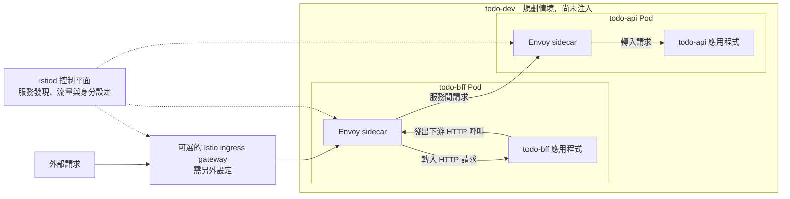

# Day 28 - Istio Sidecar 如何改變微服務流量

前一篇的政策檢查工作負載寫入 Kubernetes 時的設定。Pod 啟動後，`todo-bff` 呼叫 `todo-api` 則是另一條路徑：RBAC 不管這條 HTTP 連線，admission 也不會逐筆檢查它。若要統一管理服務間的流量規則，可以評估服務網格（Service Mesh）。

這篇以 **Istio Sidecar 模式**說明請求會經過哪些元件，以及多一層 proxy 帶來的成本。現有 Todo API／BFF 位於 `todo` Namespace，沒有 Istio 安裝、注入設定或流量規則；圖中的 Todo Dev 是規劃情境，不是目前已運作的網路。

## 誰處理請求，誰發佈規則？

在 Sidecar 模式下，Envoy proxy 和應用程式位於同一個 Pod。符合流量攔截設定的請求會經過 proxy：`todo-bff` 的 HTTP client 發出請求，經呼叫端 Envoy 送往接收端 Envoy，再交給 `todo-api`。應用程式仍負責 Todo 的處理邏輯，proxy 則執行 mesh 的流量規則並產生觀測資料。這些實際轉送請求的 proxy 組成**資料平面（Data Plane）**。

`istiod` 是**控制平面（Control Plane）**，負責讓 proxy 取得服務發現、流量與安全設定，以及工作負載身分相關資訊。它不在每一筆 Todo 請求的轉送路徑上。外部流量可透過另行設定的 ingress gateway 進入 mesh，但 BFF 呼叫 API 不需要繞回 gateway。

下圖以實線表示業務請求，虛線表示控制平面下發資訊。這裡沒有把既有 NGINX Ingress 自動改成 Istio gateway；若要更換入口，需要另外規劃。

## 「不用改程式」不等於「部署沒有成本」

Sidecar injection 通常不需重寫應用程式的 HTTP client，但要先安裝 Istio、設定注入條件，再建立新的 Pod。只修改 Namespace label，不會讓原有 Pod 憑空多出一個 container；也不能只看 Namespace 已標記，就認為所有服務都進入了 mesh。

每個 proxy 都需要 CPU 與記憶體，也會參與連線處理。既有 Todo API `Deployment` 還沒有 CPU／memory limits，導入前應先盤點應用程式與 proxy 的資源需求，不能把 sidecar 當成沒有成本的附加功能。

流量路徑改變後，還要檢查 Pod 啟動與 probe 的順序、HTTP／gRPC 協定辨識、對外流量（egress），以及未加入 mesh 的 client。既有 OTel 資料也需要對照：proxy 可以觀察連線和請求，卻不會自動取代 API 內的 `todo.create` 業務 span；兩邊的 trace、metric 是否重複或能正確關聯，要實際確認。

## 哪些需求值得加入 proxy？

如果只需要限制叢集網路的連線範圍，可以先評估 `NetworkPolicy`；若需要統一的工作負載身分或 HTTP 流量規則，才有理由進一步衡量 Istio。兩者處理的層次不同，不能只因為都與網路有關就互相替代。

Istio 也不會取代 Kubernetes RBAC、admission、image 來源檢查或應用程式的使用者授權。是否導入，要看團隊是否需要它提供的流量控制，以及能否負擔 proxy、控制平面和故障排查的維運工作。

## 如果要試，先確認原本的服務仍然可用

一個可控的驗收情境是先在隔離的非 Production 環境確認 `todo-bff` 呼叫 `todo-api` 的原始路徑，再逐個工作負載加入 sidecar，對照 Pod container 數、proxy 就緒、請求結果及 trace／log。尚未加入 mesh 的 client 也要納入測試；同時更改 injection、流量規則與加密模式，會讓失敗很難定位。

這些是導入時要取得的證據，目前還沒有注入或流量測試結果。下一篇會把 mTLS 的傳輸身分與 `AuthorizationPolicy` 的服務授權拆開，看兩者各自擋得住什麼。
