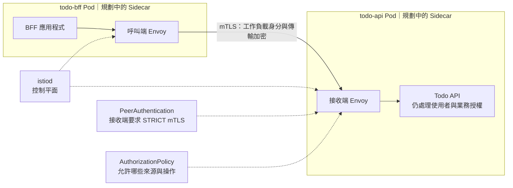

# Day 29 - Istio 如何處理服務間流量、mTLS 與授權

前一篇的 admission 檢查資源設定，但 BFF 呼叫 Todo API 的 HTTP 請求，不會逐筆通過 RBAC 或 Gatekeeper。若要統一處理服務間的流量與工作負載身分，可以評估服務網格（Service Mesh）。

這裡以 Istio 的 Sidecar 模式介紹流量、加密與授權。叢集已有 Istio 控制平面元件，但 Todo API 與 BFF 目前不是帶有 Envoy sidecar 的 Pod；沒有這組服務的 mTLS 與授權驗證，不能因為看見 `istiod` 就認為 Todo 已加入 mesh。

## Proxy 轉送請求，控制平面下發規則

在 Sidecar 模式下，Envoy 和應用程式位於同一個 Pod。符合攔截設定的 BFF 呼叫，經呼叫端 Envoy 送到 API 的 Envoy，再交給應用程式。proxy 執行流量規則與產生觀測資料，應用程式仍負責 Todo 功能。

這些轉送請求的 proxy 是資料平面（Data Plane）；`istiod` 是控制平面（Control Plane），下發服務發現、流量與身分相關設定，不會介入每筆 Todo 請求。服務間呼叫也不必繞回 ingress gateway。

下圖是尚未套用到 Todo 的 Sidecar 路徑。虛線是控制設定，實線是業務請求。

## mTLS 確認身分，授權決定能不能呼叫

雙向傳輸層安全性（mutual TLS，mTLS）讓兩側 proxy 用憑證相互驗證工作負載並加密連線。接收端以 `PeerAuthentication` 要求 `STRICT` 時，送到其受管入口的明文連線會被拒絕。

可信的憑證不代表有權呼叫 Todo API。`AuthorizationPolicy` 才能依來源 principal，以及可辨識的 HTTP method、path 等條件限制請求。若有 `ALLOW` 政策適用於 API，請求必須命中至少一條適用的允許規則；完全沒有適用的 `ALLOW`，就不能宣稱已有白名單。其他 `DENY` 等政策也要一起考慮。

假設只允許 BFF 執行特定操作，而且沒有其他政策影響判斷：

| 請求 | 預期結果 |
| --- | --- |
| BFF 使用 mTLS，操作命中允許規則 | 通過 mesh 檢查，交給 API |
| 其他可信工作負載使用 mTLS | 身分驗證可通過，但未命中 `ALLOW`，拒絕 |
| BFF 身分正確，method 或 path 未獲准 | 拒絕該操作 |
| 明文 client 連到要求 `STRICT` 的受管入口 | 拒絕連線 |

要區分 BFF 與其他服務，必須先安排各自的 `ServiceAccount`，確認 Pod 真正使用該身分。共用預設身分，就不能只靠 ServiceAccount principal 分辨來源。這份身分是服務間授權的依據，不表示應用程式需要額外的 Kubernetes API 權限。

mTLS 也不是瀏覽器到 API 的全程加密保證；同一 Pod 內 proxy 與程式之間，以及沒經過 proxy 的流量，要看各自的設定。至於登入使用者能不能讀取別人的 Todo，仍由應用程式授權判斷。

## 增加 Sidecar 前先看成本與依賴

proxy 需要 CPU、記憶體，也改變連線和故障排查路徑。設定 injection label 不會讓既有 Pod 自動多出 sidecar，還需要重建，並檢查 probe、協定辨識、egress 與尚未加入 mesh 的 client。

如果需求只是限制網路連線範圍，可以先評估 `NetworkPolicy`。需要工作負載身分、統一的 HTTP 流量規則時，再衡量 Istio 的控制平面、proxy 與維運成本。proxy 的遙測資料也不會取代 `todo.create` 這類應用程式業務 span。

導入時，先確認原有 BFF 到 API 的路徑，再逐項加入 sidecar、mTLS 和授權。每一步都要證明必要請求仍通過、不該允許的請求被拒絕；HTTP 成功本身不證明用了 mTLS，拒絕也可能發生在 Envoy、根本沒有到 API log。

這些限制回應了 Day 01 的安全期待：API 權限、資源政策與服務流量需要不同機制，不能靠一個工具全部包辦。下一篇回顧這 30 篇已完成的部分，以及還沒接通的交付路徑。
