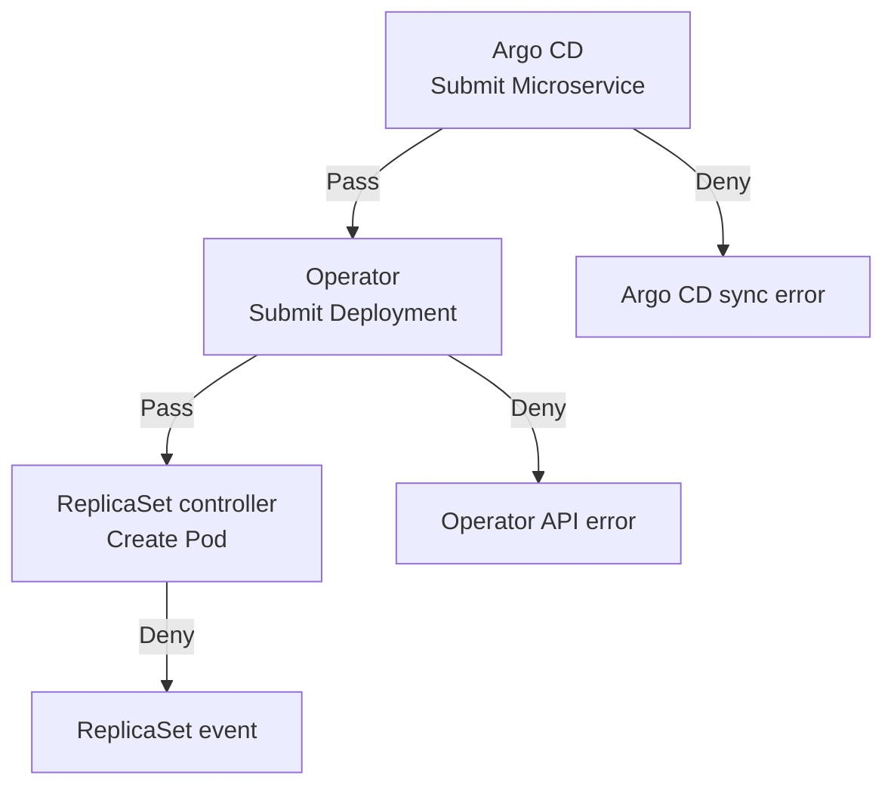

# Day 29 - 把 Gatekeeper 政策放進平台交付流程

前一篇用禁止 `privileged` 的例子，說明 Gatekeeper 如何在資源寫入前檢查設定。不過，如果叢集裡已經有服務在跑，今天才加上一條新規則，原本可以正常更新的服務，會不會突然被擋住？

假設我們要求每個容器都要設定 CPU 與 memory limits，但某份既有的部署設定少了 memory limit。開發者下次只想換 image，卻可能因為缺少 limit 而被拒絕。要避免在換版時才發現這個問題，就得先檢查既有設定，再決定何時開始拒絕。

今天沿用 Todo API，從 limits 與 image 的要求開始，看政策怎麼逐步導入，以及被拒絕後要去哪裡找原因。

## 想加哪些部署規則？

除了前一篇的 `privileged`，我們還可以替 Todo API 加上兩種要求。

第一種是容器必須設定 CPU 與 memory limits，限制可使用的資源量。目前 Operator 已經替 Todo API 設定這些欄位，但其他服務不一定有。如果政策要涵蓋 `todo` Namespace 裡的所有容器，就要逐一檢查，不能只看 Todo API。設定了 limits，也不代表額度一定合適，或整個 Namespace 的總用量已經受到限制。

第二種是 image 必須來自指定的 repository，例如 `ghcr.io/yrw9281/it30-todo-api`，並使用 digest 固定內容。來源符合要求，但仍使用可以重新指向的 tag，不符合這條規則；其他 repository 的 image 即使帶有 digest，也不能通過。通過這些檢查，只代表來源與版本格式符合要求，不代表 image 沒有漏洞或建置來源已經驗證。

目前 Backstage 模板讓開發者輸入 digest，再組成固定來源的 image。不過，`Microservice` 的自訂資源定義（Custom Resource Definition，CRD）仍接受 tag。如果有人直接提交自訂資源（Custom Resource，CR）而不經過 Backstage，就不會受到表單限制，因此不能只依賴入口檢查。

這兩種規則也有不同的檢查位置：image 可以先檢查 `Microservice.spec.image`；limits 則是 Operator 產生的容器設定，要檢查 `Deployment` 或 Pod，不能只看 CR。

## 先檢查既有設定，再開始拒絕

有了規則，先不要急著阻擋交付。Gatekeeper 的稽核（audit）會定期檢查符合政策範圍的既有資源，記錄哪些資源違規、原因是什麼，但不會替我們修改或刪除它們。

以 limits 為例，audit 可以幫忙找出哪些工作負載缺少 CPU 或 memory limit。平台團隊再確認是原本漏填，還是某個容器需要另外評估。這樣就能在下一次部署前處理，而不是等開發者換版時才收到拒絕。

盤點期間，可以把 Constraint 的 `spec.enforcementAction` 設為 `dryrun`。這個模式不會阻擋請求，適合搭配 audit 確認規則是否涵蓋正確的資源。它與 Kubernetes 只檢查、不儲存資源的 `server-side dry-run` 不同；使用 Gatekeeper 的 `dryrun` 時，資源仍然可以寫入。

修正設定後，再到測試環境確認：符合要求的設定能提交，缺少 limit 的設定會被拒絕，而且拒絕原因指出哪個容器、哪個欄位有問題。確認現有服務能正常換版後，才把準備好的範圍改成 `deny`，正式拒絕違規請求。

如果想先提醒提交者，也可以使用不阻擋、只回傳 API 警告的 `warn`，但要確認提交工具真的會顯示警告。它是可選的過渡方式，不是切換 `deny` 前一定要經過的步驟。

Constraint 沒有指定執行模式時，預設就是 `deny`，所以盤點階段要明確設定 `dryrun`。切成 `deny` 也不會刪掉既有違規資源，但它們下一次更新可能被擋。即使只換 image，更新後的設定仍缺少 limit，就仍然可能被拒絕。

## 被拒絕時，要去哪裡找原因？

Todo 平台的交付設計是由 Argo CD 提交 `Microservice`，Operator 依 CR 提交 `Deployment`，最後由 Kubernetes 的 controller 建立 Pod。這是不同元件各自提出的 API 請求，錯誤也會回到不同元件。

下面假設 Gatekeeper 已經檢查這三種資源。圖中的 `Pass` 與 `Deny` 表示每次提交時的政策檢查結果；這是流程示意，目前叢集尚未安裝 Gatekeeper，還沒有政策拒絕的實測結果。

如果 `Microservice` 被拒絕，就看 Argo CD 的同步錯誤。這次 CR 變更沒有寫入，Operator 不會依這份變更更新工作負載。如果是更新被拒絕，原本的 CR 仍然保留，不會因為這次失敗就被刪除。

如果 CR 已經成功寫入，卻在 Operator 提交 `Deployment` 時被拒絕，就要查 Operator 的 API 錯誤。這不是 Argo CD 提交 CR 的同步失敗。目前 Operator 會記錄 HTTP status 並重試，還沒有把政策拒絕的具體原因回報到 CR 狀態。這段回饋仍需要補上，否則開發者可能只知道新版沒出來，卻不知道缺少哪個設定。

如果 `Deployment` 也建立了，但後續建立 Pod 被拒絕，就要查 `ReplicaSet` 事件。這時新的 Pod 根本沒有建立，找 Pod log 也找不到拒絕原因。Operator 可能之後才從部署進度逾時發現問題，但那仍不等於直接顯示政策訊息。

因此，CR 同步成功不代表新版已經完成部署。查錯誤時，要先確認這次變更走到哪一步，再查看提交該資源的元件。

## image 與 limits 分別要在哪裡修正？

回到開頭的例子：如果缺少 memory limit 是 Operator 的預設問題，就應該由平台團隊修正 Operator。不應要求開發者直接修改受 Operator 管理的 `Deployment`，下一次執行 `reconcile` 時，Operator 又可能把它改回去。

如果是 image 的來源或版本格式不符合要求，就回到 `Microservice` 與設定 Pull Request（PR）修正。Backstage 表單與 Git 檢查可以提早提醒，Gatekeeper 則在資源寫入前檢查；修改政策時，這幾個地方的要求也需要一起核對。

確實需要例外的資源，應記錄理由、負責人與重新檢討時間，並限制誰能修改政策或排除檢查。不能讓任何提交者自行加一個 label 就跳過規則。

另外，也要決定 Gatekeeper 故障時怎麼處理。webhook 的 `failurePolicy` 設為 `Ignore`，會在呼叫失敗時繼續其他檢查，可能讓未經政策驗證的設定寫入；設為 `Fail` 則會拒絕，正常部署也可能被擋住，因此需要準備恢復方式。這與政策判定違規不同：`Ignore` 不會忽略 Gatekeeper 正常回傳的拒絕結果。

一條政策能拒絕違規設定之後，還要讓提交者知道怎麼修。像「`todo-api` 容器缺少 `resources.limits.memory`」，就能讓平台團隊回頭檢查 Operator 的預設；只顯示「部署失敗」，則無法判斷該由誰處理。

下一篇會回到 Todo API，展示這個系列已有的交付與查詢成果，也整理還需要串接的部分。

## 參考資料

- [Gatekeeper：audit 與違規結果](https://open-policy-agent.github.io/gatekeeper/website/docs/audit/)
- [Gatekeeper：`dryrun`、`warn` 與違規記錄](https://open-policy-agent.github.io/gatekeeper/website/docs/violations/)
- [Gatekeeper：webhook 故障時的拒絕設定與取捨](https://open-policy-agent.github.io/gatekeeper/website/docs/failing-closed/)
