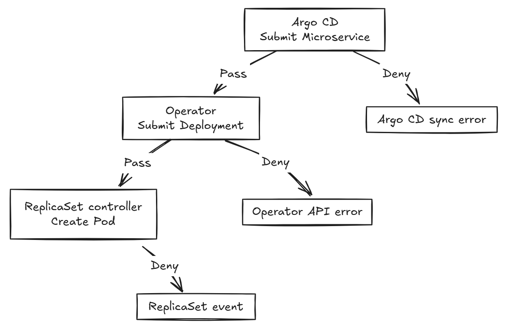

# Day 29 - 把 Gatekeeper 政策放進平台交付流程

前一篇用禁止 `privileged` 的例子，說明 Gatekeeper 如何在資源寫入前檢查設定。今天把這個要求寫成 `ConstraintTemplate`，再加入 CPU／memory limits 與 image 的規則，看看三條政策怎麼各自設定範圍與執行模式。

以下沿用 Todo API，提供完整的政策 YAML。使用前需要已安裝 Gatekeeper；每組設定都要先建立 Template，等它產生的自訂資源定義（Custom Resource Definition，CRD）就緒，再建立對應的 Constraint。

## `k8sdeploymentnoprivileged`：禁止 privileged

先把前一篇的需求實作出來：Todo API 不需要操作主機裝置，因此不允許容器啟用 `privileged`。

```yaml
apiVersion: templates.gatekeeper.sh/v1
kind: ConstraintTemplate
metadata:
  name: k8sdeploymentnoprivileged
spec:
  crd:
    spec:
      names:
        # Gatekeeper 會建立這個 Kind，供後面的 Constraint 使用。
        kind: K8sDeploymentNoPrivileged
      validation:
        # 定義 parameters 的格式；這條固定規則不需要額外參數。
        openAPIV3Schema:
          type: object
  targets:
    - target: admission.k8s.gatekeeper.sh
      # | 以下的多行文字是 Rego，不是 YAML 欄位。
      rego: |
        package k8sdeploymentnoprivileged

        # 找到違規容器就回報 msg；是否拒絕由 Constraint 決定。
        violation[{"msg": msg}] {
          input.review.kind.kind == "Deployment"
          # Deployment 的容器在 Pod template 中，不在 spec.containers。
          pod_spec := input.review.object.spec.template.spec
          # := 綁定變數，[_] 逐一取出陣列元素；兩種容器都要檢查。
          field := ["containers", "initContainers"][_]
          container := pod_spec[field][_]

          # 未設定或設為 false 不違規，只有 true 才回報。
          container.securityContext.privileged == true

          msg := sprintf(
            "container <%v> must not enable securityContext.privileged",
            [container.name]
          )
        }
```

Template 只定義檢查方式，接著用 Constraint 指定要檢查 `todo` 裡的 `Deployment`：

```yaml
apiVersion: constraints.gatekeeper.sh/v1beta1
kind: K8sDeploymentNoPrivileged # 對應 Template 定義的 Kind。
metadata:
  name: todo-no-privileged
spec:
  # 示範正式拒絕模式；首次導入仍應先用 dryrun 盤點。
  enforcementAction: deny
  match:
    namespaces:
      - todo
    kinds:
      - apiGroups: ["apps"]
        kinds: ["Deployment"]
```

預期啟用 `privileged` 的容器會被這條 `deny` 規則拒絕；未啟用的容器不因這條規則被擋，但仍須通過其他檢查。

## `k8sdeploymentrequiredlimits`：要求 CPU 與 memory limits

目前 Operator 已替 Todo API 設定 limits，但 `todo` 裡的其他工作負載不一定有。這條規則同樣檢查 `Deployment` 的容器設定：

```yaml
apiVersion: templates.gatekeeper.sh/v1
kind: ConstraintTemplate
metadata:
  name: k8sdeploymentrequiredlimits
spec:
  crd:
    spec:
      names:
        kind: K8sDeploymentRequiredLimits
      validation:
        openAPIV3Schema:
          type: object
  targets:
    - target: admission.k8s.gatekeeper.sh
      rego: |
        package k8sdeploymentrequiredlimits

        # 欄位必須存在且非空；不計算上限是否合適。
        has_limit(container, resource) {
          value := container.resources.limits[resource]
          value != null
          value != ""
        }

        violation[{"msg": msg}] {
          input.review.kind.kind == "Deployment"
          pod_spec := input.review.object.spec.template.spec
          field := ["containers", "initContainers"][_]
          container := pod_spec[field][_]

          # CPU 與 memory 分別檢查，缺哪個就回報哪個。
          resource := ["cpu", "memory"][_]
          # resources 或 limits 整個沒填，也會被判定缺少欄位。
          not has_limit(container, resource)

          msg := sprintf(
            "container <%v> is missing resources.limits.%v",
            [container.name, resource]
          )
        }
```

這次先用 `dryrun` 盤點，不立即擋住既有服務的更新：

```yaml
apiVersion: constraints.gatekeeper.sh/v1beta1
kind: K8sDeploymentRequiredLimits
metadata:
  name: todo-required-limits
spec:
  # 不阻擋違規請求；從 audit 結果找出需要修正的工作負載。
  enforcementAction: dryrun
  match:
    namespaces:
      - todo
    kinds:
      - apiGroups: ["apps"]
        kinds: ["Deployment"]
```

預期缺少 memory limit 時，違規訊息會包含容器名稱與 `resources.limits.memory`。目前 Todo API 的 CPU `500m`、memory `256Mi` 都有設定，能符合這條規則，但不代表額度一定合適，或整個 Namespace 的總用量已受到限制。

## `k8smicroserviceimagepolicy`：限定 image 來源與 digest

image 可以在自訂資源（Custom Resource，CR）的 `Microservice.spec.image` 就先檢查。目前 CRD 只要求這個欄位是非空字串，像 `ghcr.io/yrw9281/it30-todo-api:0.1.0` 也能通過 schema 驗證；直接提交 CR 的人又不會經過 Backstage 表單，所以不能只依賴入口限制。

```yaml
apiVersion: templates.gatekeeper.sh/v1
kind: ConstraintTemplate
metadata:
  name: k8smicroserviceimagepolicy
spec:
  crd:
    spec:
      names:
        kind: K8sMicroserviceImagePolicy
      validation:
        openAPIV3Schema:
          type: object
  targets:
    - target: admission.k8s.gatekeeper.sh
      rego: |
        package k8smicroserviceimagepolicy

        valid_image(image) {
          # 固定 repository，並要求 sha256: 後有 64 位小寫十六進位值。
          # ^ 與 $ 限定整個字串，避免其他來源或尾端多餘文字通過。
          # :0.1.0 這類 tag 可以被重新指向，因此不符合 digest 要求。
          regex.match(
            "^ghcr[.]io/yrw9281/it30-todo-api@sha256:[0-9a-f]{64}$",
            image
          )
        }

        violation[{"msg": msg}] {
          input.review.kind.group == "platform.example.io"
          input.review.kind.kind == "Microservice"
          image := object.get(input.review.object.spec, "image", "")

          # 其他 repository 即使帶有 digest，一樣不符合這條規則。
          not valid_image(image)

          msg := sprintf(
            "Microservice <%v> spec.image must use ghcr.io/yrw9281/it30-todo-api@sha256:<64 lowercase hex characters>",
            [input.review.object.metadata.name]
          )
        }
```

對應的 Constraint 改為選擇 `Microservice`，這次示範只提醒、不阻擋的 `warn`：

```yaml
apiVersion: constraints.gatekeeper.sh/v1beta1
kind: K8sMicroserviceImagePolicy
metadata:
  name: todo-image-policy
spec:
  # 回傳 API 警告，但提交工具必須能顯示，使用者才看得到。
  enforcementAction: warn
  match:
    namespaces:
      - todo
    kinds:
      - apiGroups: ["platform.example.io"]
        kinds: ["Microservice"]
```

這個範例限定 `todo` 裡所有 `Microservice` 都使用 Todo API 的 repository，適合目前單一服務的情境。預期指定來源加上合法 digest 格式能通過；使用 tag、其他來源或長度不符的 digest 都會違規。這條規則不會掃描漏洞，也不驗證 image 的建置來源。

## `enforcementAction` 的差異

| `spec.enforcementAction` | 是否拒絕違規請求 | 回饋方式 |
| --- | --- | --- |
| `dryrun` | 否 | 不回傳政策警告，可從稽核（audit）的 `status.violations` 查看違規 |
| `warn` | 否 | 回傳 API 警告；提交工具須能顯示 |
| `deny` | 是 | 回傳拒絕原因 |

未指定時預設為 `deny`。每份 Constraint 可獨立設定模式，但只要違反任何適用的 `deny` 規則，請求就會被拒絕，其他 `warn`／`dryrun` 不會替它放行。

audit 不會修改既有資源，切成 `deny` 也不會刪除它們；下次更新若仍違反適用的規則，請求才會被拒絕。另外，Gatekeeper 的 `dryrun` 仍允許寫入，不同於 Kubernetes 不儲存資源的 `server-side dry-run`。

## 請求被拒絕時，要去哪裡找原因？

Todo 平台的交付設計是由 Argo CD 提交 `Microservice`，Operator 依 CR 提交 `Deployment`，最後由 Kubernetes 的 controller 建立 Pod。這是不同元件各自提出的 API 請求，錯誤也會回到不同元件。以下假設對應規則使用 `deny`，並另有 Pod 檢查規則：



依被拒絕的資源，可以直接對照錯誤位置：

| 被拒絕的資源 | 去哪裡查 | 這次變更的結果 |
| --- | --- | --- |
| `Microservice` | Argo CD 同步錯誤 | CR 變更未寫入，Operator 不會依這份變更部署 |
| `Deployment` | Operator 的 API 錯誤 log | CR 已寫入，但工作負載變更未寫入 |
| Pod | `ReplicaSet` 事件 | `Deployment` 已寫入，但遭拒的 Pod 沒有建立，沒有 Pod log 可查 |

## 修正設定與處理例外

找到拒絕原因後，回到設定來源修正：image 改設定 Pull Request（PR）裡的 `Microservice.spec.image`，limits 則由平台團隊修改 Operator 的預設。不要直接改受管的 `Deployment`，否則下次 `reconcile` 可能被還原。調整政策時，也要核對 Backstage 表單與 Git 檢查是否一致。

如果需要例外，可以改 Constraint 的 `spec.match` 排除例外，不必修改 Rego。整個 Namespace 用 `excludedNamespaces`；依資源 label 排除則用 `labelSelector`。例如，要讓 `metadata.labels.app` 為 `todo-api` 的 `Deployment` 不套用 limits 檢查，可以把前面的 `todo-required-limits` 改成：

```yaml
apiVersion: constraints.gatekeeper.sh/v1beta1
kind: K8sDeploymentRequiredLimits
metadata:
  name: todo-required-limits # 修改同一份 Constraint，不是另加一條規則。
spec:
  enforcementAction: dryrun
  match:
    namespaces:
      - todo
    kinds:
      - apiGroups: ["apps"]
        kinds: ["Deployment"]
    labelSelector:
      matchExpressions:
        - key: app
          operator: NotIn # 排除 app=todo-api，其餘仍檢查。
          values: ["todo-api"]
```

這裡比對的是 `Deployment.metadata.labels`，不是 Pod template 的 label；沒有 `app` label 的資源仍會被檢查。例外只影響這份 limits Constraint，不會跳過 privileged 或其他規則。這也是 label 比對，不是資源名稱比對：任何能把 `app` 改成 `todo-api` 的提交者，都能符合這個排除條件。

## 參考資料

- [Gatekeeper：ConstraintTemplate 與參數 schema](https://open-policy-agent.github.io/gatekeeper/website/docs/constrainttemplates/)
- [Gatekeeper：Constraint 的 match 與 labelSelector](https://open-policy-agent.github.io/gatekeeper/website/docs/howto/#the-match-field)
- [OPA：Rego 的規則與語法](https://www.openpolicyagent.org/docs/policy-language)
- [Gatekeeper：audit 與違規結果](https://open-policy-agent.github.io/gatekeeper/website/docs/audit/)
- [Gatekeeper：`dryrun`、`warn` 與違規記錄](https://open-policy-agent.github.io/gatekeeper/website/docs/violations/)
