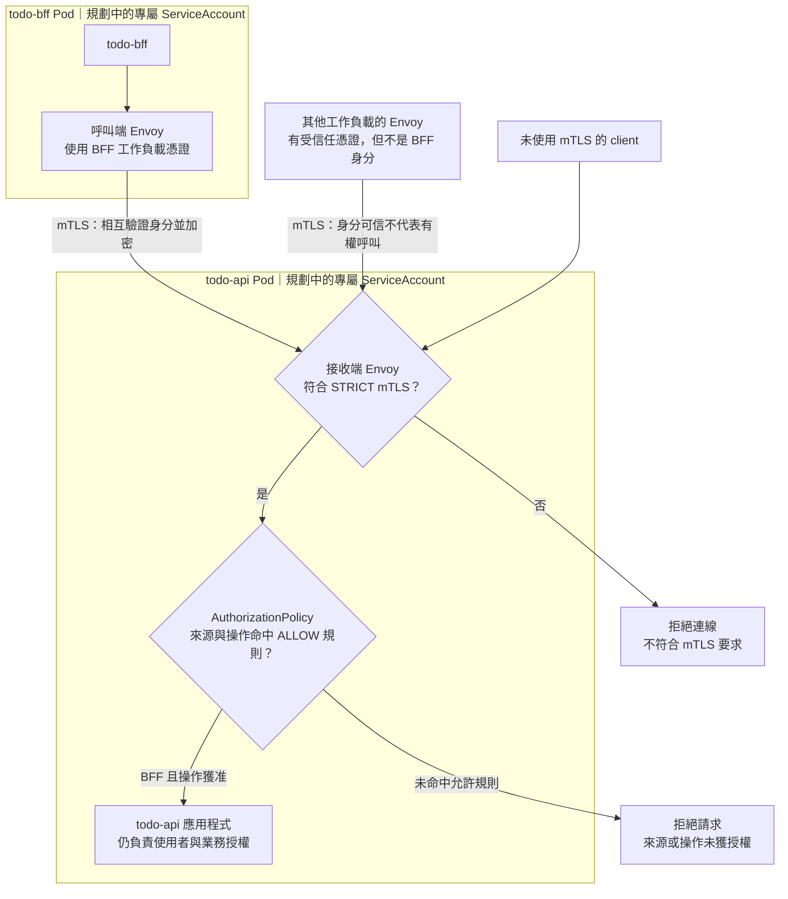

# Day 29 - mTLS 與 AuthorizationPolicy 各擋什麼

前一篇讓我們看見 Sidecar 模式的流量路徑，但請求經過 Envoy，不代表來源都獲准呼叫 API。假設 `todo-api` 只應接受 `todo-bff` 的特定呼叫，就要先辨識來源工作負載，再決定這個身分是否有權存取。

Istio 的雙向傳輸層安全性（mutual TLS，mTLS）用憑證相互驗證工作負載身分並加密傳輸，`AuthorizationPolicy` 再限制哪些請求可以通過。現有 Todo 工作負載沒有 Istio Sidecar、專屬 `ServiceAccount` 或 mesh 政策；本篇用允許與拒絕情境說明兩者的分工。

## mTLS 驗證工作負載，不判斷業務權限

在 Sidecar 模式下，mTLS 保護的是兩側 Envoy 之間的連線。接收端可透過 `PeerAuthentication` 要求 `STRICT` 模式，拒絕送到其受管流量入口的明文連線；但憑證可信，只能確認對方的工作負載身分，還不能決定它是否應該呼叫 `todo-api`。

這也不是瀏覽器到應用程式的全程 TLS 保證。同一 Pod 內 proxy 與應用程式之間的連線，以及沒有經過 proxy 的流量，要依各自的配置判斷，不能直接套用這段 mTLS 的結論。

## 先讓 BFF 與 API 有可區分的身分

身分設計還有一個容易漏掉的前提：若 `todo-bff` 和其他服務共用預設的 `ServiceAccount`，只靠 ServiceAccount principal 無法把它們區分成兩個允許對象。規劃白名單前，得先替需要區分的工作負載建立各自的 `ServiceAccount`，確認 Pod 真正使用它，再核對 mesh 所見到的來源身分。目前的原生 Todo manifests 沒有這項設定。

專屬 `ServiceAccount` 在這裡用於區分工作負載，不表示服務需要額外的 Kubernetes API 權限。Pod 使用哪個身分，以及誰能建立使用該身分的工作負載，也必須受平台權限限制。

## `AuthorizationPolicy` 才決定誰能呼叫

以 `todo-api` 為目標，可以規劃一份選取其 Pod 的 `ALLOW` 政策，依來源 principal 只允許 `todo-bff`。若還要限制 HTTP method 與 path，就得確認 proxy 能辨識協定，而且規則對應 BFF 實際送出的請求。

這裡要區分「政策選到工作負載」與「請求命中規則」。當有 `ALLOW` 政策適用於 `todo-api` 時，請求必須命中至少一條適用的允許規則；沒有命中就拒絕。若完全沒有適用的 `ALLOW` 政策，不能宣稱已有白名單保護。既有的 `DENY` 等政策也要一起檢查，不能只看單一 `ALLOW` 就斷定請求一定通過。

下圖假設接收端要求 `STRICT` mTLS，且只有一份針對 `todo-api` 的 `ALLOW` 政策，沒有其他政策影響判斷。專屬身分與 Istio 都尚未建立，圖中只呈現預期的判斷邊界。

這仍不取代應用程式的使用者授權。Istio 可辨認是哪個工作負載送來請求，卻不知道某位登入使用者是否有權讀取另一人的 Todo。Kubernetes RBAC 限制的是 API 動作，也不會替 HTTP 端點做業務權限判斷。

## 切到強制模式之前先盤點依賴

若一開始就要求 `STRICT` mTLS，仍使用明文的必要 client 可能斷線；`ALLOW` 清單漏掉必要的監控或背景工作，也可能讓 Pod 正常啟動，功能卻無法使用。健康檢查則要確認 Istio 是否改寫 probe，以及實際檢查路徑，不宜一律當成普通 HTTP client 加入白名單。

導入前應列出呼叫 `todo-api` 的來源，逐一確認工作負載身分、proxy、必要的 HTTP／gRPC 操作與例外路徑，再到隔離環境檢查：

| 請求情境 | 上述設計的預期結果 |
| --- | --- |
| BFF 以 mTLS 執行獲准操作 | 通過 mesh 檢查，交給 API 處理 |
| 其他可信工作負載使用 mTLS | 身分驗證可通過，但因未命中 `ALLOW` 而拒絕 |
| BFF 身分正確，method 或 path 不在規則內 | 拒絕該請求 |
| client 以明文連到要求 `STRICT` 的受管入口 | 拒絕連線，不進入 API |

驗收時要同時看請求結果與 proxy 的觀測資訊。HTTP 成功不證明使用了 mTLS；拒絕若發生在 Envoy，應用程式也可能沒有收到請求，不能只靠 API log 排查。目前尚無對應設定、測試 client 或結果。

下一篇會回顧這 30 篇留下的範例與設計，整理要把它們接成可運作平台，還缺哪些工作。
