# Day 30 - 平台工程系列回顧

第一天問的是「微服務寫完後，怎麼交付？」最後一天，我們站在維護 Todo 的開發者角度，以更新 Todo API 的 Dev image 為例，看看怎麼提出換版需求，又要去哪裡確認結果。

## 先看看正在使用的 Todo

打開 Todo 網頁，可以看到新增、勾選完成與刪除待辦的操作，畫面裡已有一筆測試待辦。換版後，我們也會回到這裡驗證這些功能。

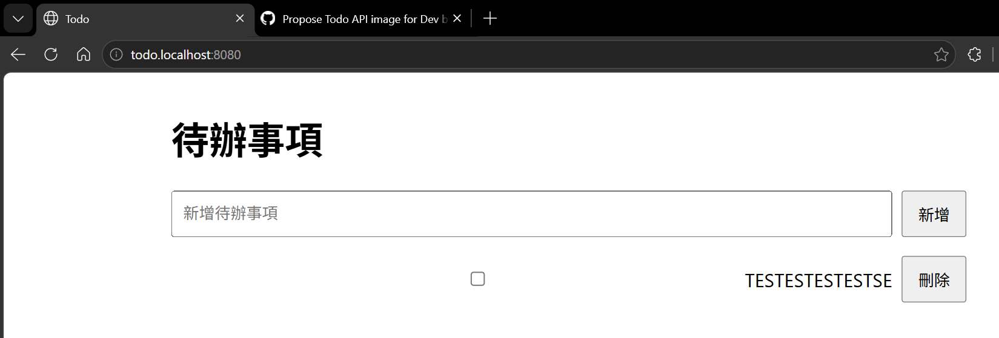

功能頁面看得到操作結果，但如果請求變慢，就需要更多資訊。Grafana 的 `Todo service overview` 可以比較 `todo-api` 與 `todo-bff` 的請求量和 p95 延遲，也能依 route 篩選。這些 Metrics（指標）讓我們觀察一段時間內的變化，而不只憑一次操作判斷服務狀況。

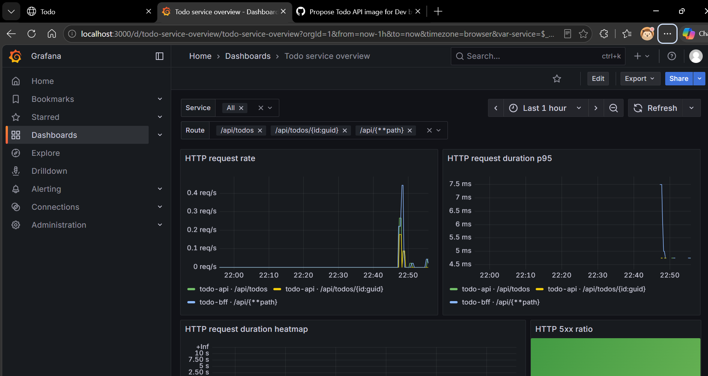

換版前，我們也先查看 Argo CD 的 `todo-full-api`。目前的狀態是 `Synced` 與 `Healthy`，資源樹可以看到 `Microservice`，以及 Operator 為它建立的 `Deployment` 和 `Service`。

`Synced` 表示受管設定與 Git 一致，`Healthy` 則是依健康檢查判斷的結果。這張圖是換版前的現況，後面還要確認新版本的狀態。

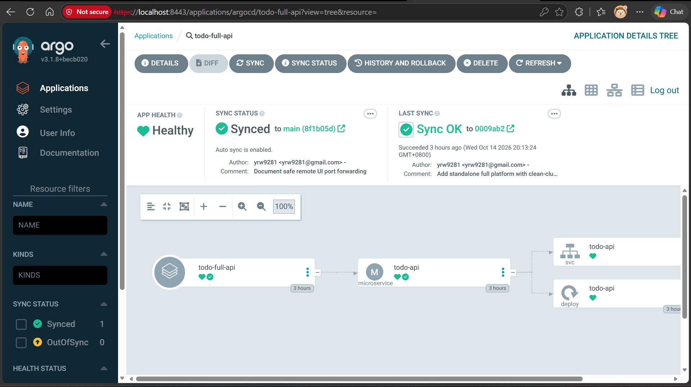

## 在 Backstage 提出換版需求

確認目前的服務狀況後，我們到 Backstage 找服務入口。Catalog 列出了 `todo-api`、`todo-bff` 與 `web`，`Owner` 都是 `todo` 團隊。這份目錄幫我們辨認服務與負責團隊，但列在 Catalog 裡，不代表服務已部署或健康。

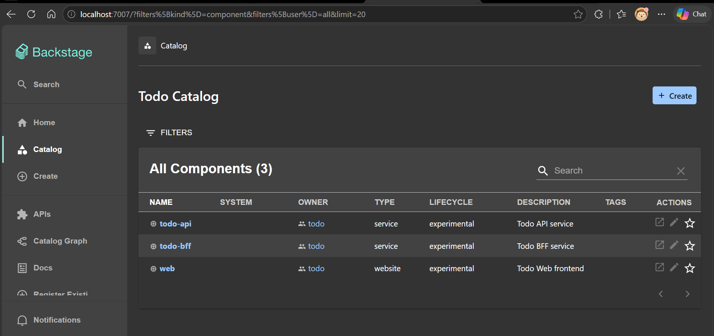

這次要更新的是既有的 Todo API。在 `Create` 裡選擇 `Update Todo API in Dev`，填入準備部署的 image digest。表單只收集 `sha256:` 後的 64 位小寫十六進位值；服務名稱、`todo` Namespace 與 port `8080` 都由模板固定。

開發者決定要交付哪個 image，不必每次重寫整份 `Deployment`。雖然入口叫 `Create`，這份模板做的是提出換版需求，不會另外建立一個服務或環境。

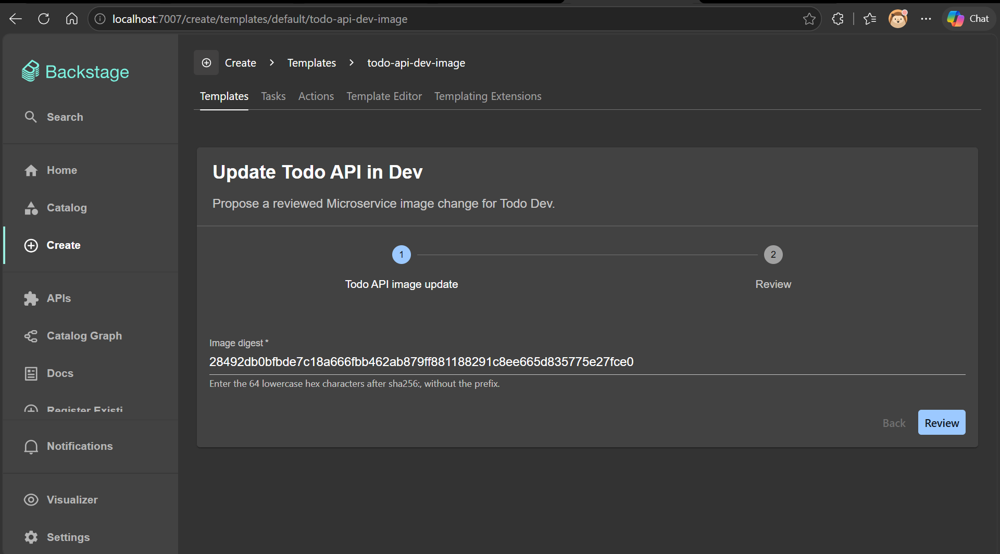

## 到 GitHub 查看實際變更

送出表單後，Backstage 會產生 `Microservice` 設定，提出設定變更提案（Pull Request，PR）。開啟這筆 PR 的 `Files changed`，可以看到只有 `spec.image` 的 digest 改變，服務名稱、Namespace 和 port 都維持原樣。

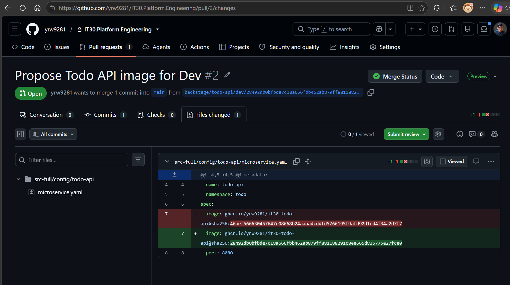

這樣審查者就能直接確認這次要更換的版本。不過，digest 格式正確不代表 image 已通過測試，仍要核對建置來源與測試結果。畫面中的 `Checks` 是 `0`，不能把這筆 PR 當成自動化設定檢查已通過的證據。

PR 此時還是 `Open`。換版需求已經送出，但 `main` 尚未改變，叢集也不應因為表單送出就直接換版。

## 核對換版前後的部署狀態

在合併前，回到 Argo CD 查看 Todo API 的 `Deployment`，image 的 digest 仍以 `46aef566` 開頭。Operator 設定的 `OTEL_SERVICE_VERSION` 也使用同一份 image reference，讓遙測資料帶上版本資訊。

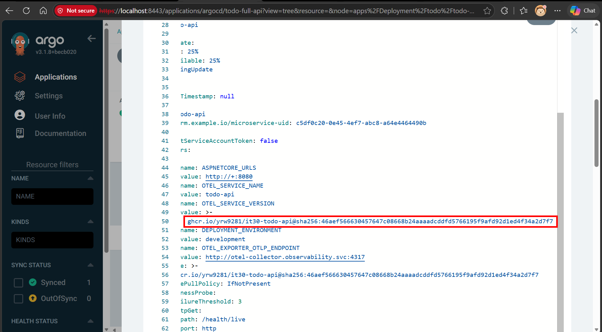

確認變更後，由有權限的人將 PR 合併到 `main`。GitHub 的狀態改為 `Merged`，這才讓新設定進入 Argo CD 讀取的分支。

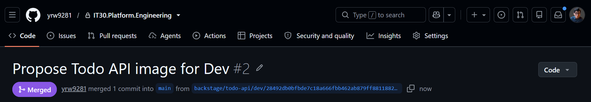

接下來由 Argo CD 同步 `Microservice`，Operator 依新的設定執行 `reconcile`，更新 Todo API 的工作負載。Backstage 不直接修改叢集，也不取代這兩個 controller。

再看 `Deployment`，image 的 digest 已改成以 `28492db0` 開頭，與表單輸入及 PR 的變更相符。`OTEL_SERVICE_VERSION` 也一起更新。

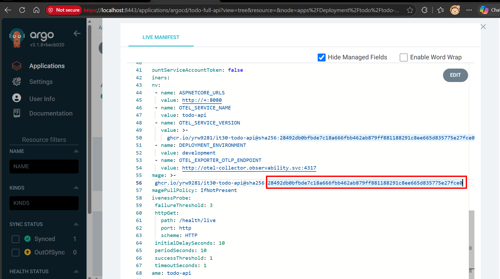

image 欄位的變化只確認了設定已更新，我們還要查看這次換版的同步與就緒狀態。回到 `todo-full-api`，Argo CD 已同步到合併 PR 後的 commit `2e1bc96`，狀態是 `Synced` 與 `Healthy`。

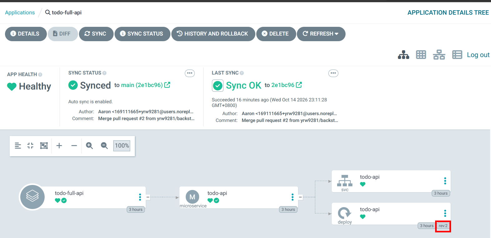

在 `Microservice` 的 Live manifest 中，`Ready` condition 的 `status` 是 `"True"`，`observedGeneration` 是 `2`，與 `metadata.generation` 的 `2` 一致。Operator 回報的就緒狀態對應目前這份設定，condition 的訊息也指出新版副本與 Service endpoints 都已就緒。

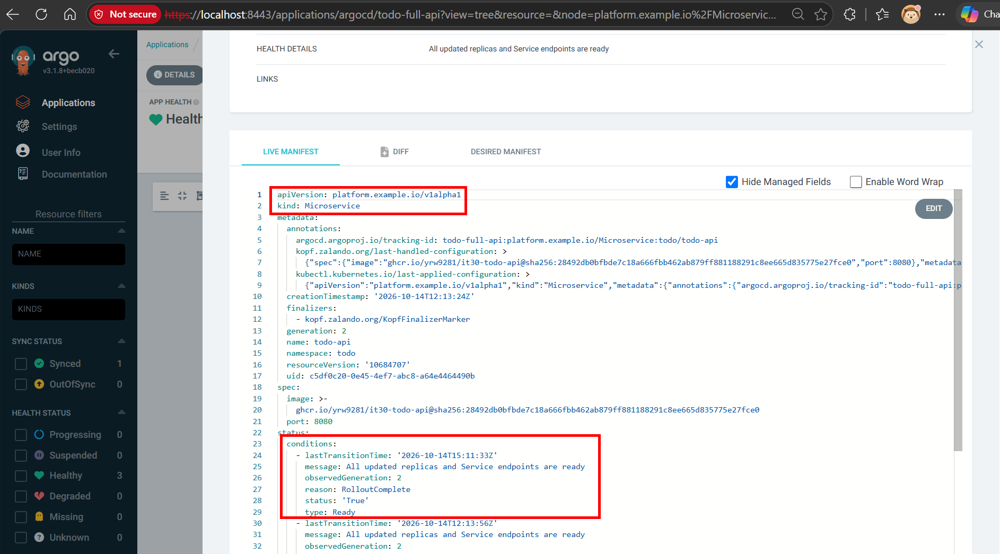

最後查看實際執行的 Todo API Pod。它的狀態是 `Running`，容器的 `ready` 為 `true`，`image` 與 `imageID` 都包含以 `28492db0` 開頭的 digest，與這次提出的版本相符。

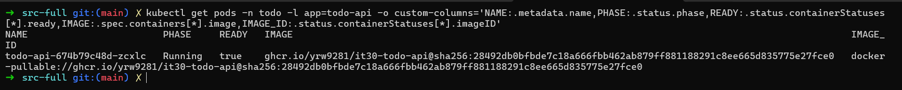

部署就緒後，仍要回到 Todo 驗證新增、完成與刪除功能，並用 Grafana 查看請求是否異常。Pod 就緒與功能正常是兩件事，這些部署狀態不能代替功能測試。

## 這 30 天學到了什麼？

### Kubernetes 與部署基礎（Day 01–05）

我們從 `Deployment`、`Service` 與 `Ingress` 理解服務怎麼執行、連線與接收外部請求。Kubernetes 以控制迴路（Control Loop）持續處理目標狀態與目前狀態的差異；Helm、Kustomize 協助管理設定，自訂資源定義（Custom Resource Definition，CRD）則擴充 Kubernetes API，讓我們能用 `Microservice` 這類自訂資源表達平台合約。

### GitOps 部署（Day 06–08）

Git 保存部署設定與變更紀錄，Argo CD 讀取設定並同步到叢集，`ApplicationSet` 則協助產生多個 `Application`。我們也學到同步與健康是兩種判斷：設定一致之後，仍要確認工作負載是否就緒。

### 可觀測性（Day 09–13）

Metrics 顯示趨勢，Logs 記錄事件，Traces 串起跨服務的同一筆請求。OpenTelemetry 與 Collector 讓服務用一致的方式送出、處理遙測資料，再透過 Prometheus、Loki、Tempo 與 Grafana 查詢。遇到延遲或錯誤時，我們有資料可以追查原因。

### CI 與 GitOps 的交界（Day 14–16）

持續整合（Continuous Integration，CI）負責程式檢查、建置與發布 image，digest 用來固定要交付的內容。要不要部署到某個環境，則透過另一筆 Git 設定變更決定。建置完成與核准部署的責任因此分開，不需要讓 CI 直接修改叢集。

### Backstage 與 Operator 的交付流程（Day 17–26）

Backstage 是內部開發者平台（Internal Developer Platform，IDP）的入口。Catalog 幫我們找到服務，模板收集需求並提出 PR。Argo CD 同步 `Microservice`，Kopf Operator 依平台預設管理工作負載並回報健康。Kubernetes plugin 提供資源現況查詢，但這些現況不等於完整的交付事件歷史。

### API 權限與資源政策（Day 27–29）

Namespace 區分資源範圍，角色型存取控制（Role-Based Access Control，RBAC）決定哪些身分能查詢或修改資源。Gatekeeper 再檢查 `privileged`、資源 `limits` 與 image 設定，依 `dryrun`、`warn`、`deny` 決定如何回饋或拒絕。這段處理的是 API 權限與資源政策，沒有展開服務間的流量安全設計。

回到開發者的工作，我們仍要決定交付哪個版本、檢查變更並驗證功能。平台把常見設定與交接方式固定下來，也讓我們知道需求送出後由誰處理、該到哪裡查看結果。

## 感謝

謝謝你讀到這裡，也謝謝一路跟著實作的讀者。

這個系列的文章與範例，[都會上傳放在 GitHub-IT30.Platform.Engineering](https://github.com/yrw9281/IT30.Platform.Engineering)，目前隱藏中，待我整理完之後再公開，方便大家回查與練習。
