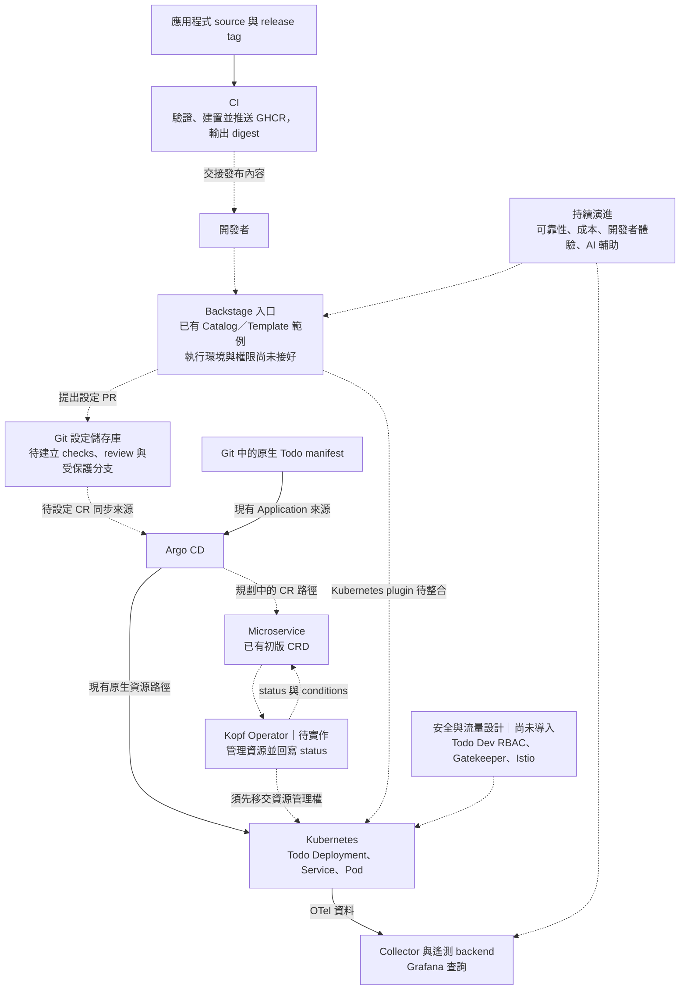

# Day 30 - 30 篇後：把微服務交付流程變成平台

## 前言

Day 01 問的是：微服務能跑之後，誰負責建置、部署、觀察與維護？一路走到前一篇的服務間授權，可以看見這些工作有不同的輸入、權限與判斷條件，不能交給一個「部署成功」的訊號概括。

這 30 篇留下了 Todo 的部署、可觀測性與 CI 範例，也規劃了以 Backstage、Git、Argo CD 和 Operator 串起的交付流程。它還不是一套能直接上線的完整平台。這篇將已有範例與尚未完成的部分放在一起，整理下一步應該取得哪些證據。

## 哪些已有範例，哪些仍是設計？

Kubernetes 提供服務的執行與連線資源，GitOps 管理要同步的設定，CI 產出 image，遙測資料則讓我們在執行時找問題。這些部分已有各自的範例，但「各自存在」與「已串成同一條交付路徑」仍有差別：

| 範圍 | 已有內容 | 還不能據此宣稱什麼 |
| --- | --- | --- |
| Kubernetes | Todo 的 `Deployment`、`Service`、`Ingress` 與初版 `Microservice` CRD | 建立 CR 不會自動產生工作負載，Operator 尚未實作 |
| GitOps | Argo CD `AppProject` 與 `Application`，讀取既有原生 manifest | 尚未讀取 Dev 的 `Microservice` 設定 |
| 可觀測性 | Todo API／BFF 的 OTel instrumentation、Collector、Prometheus、Loki、Tempo 與 Grafana 設定 | 單一副本、`emptyDir` 的範例不具備正式環境的持久化與高可用性 |
| CI 與 image | PR 檢查、服務專屬 release workflow、GHCR image 與 digest 輸出 | 尚無 unit test project，也沒有自動更新 GitOps 設定 PR |
| Backstage | Catalog、Software Template 與本機結構／替換檢查 | 尚未完成執行環境、Git 權限或 Kubernetes plugin 整合 |
| CR health | Lua Health Check 範例與狀態合約 | CRD 尚無 `conditions`，沒有 Operator 回寫，也沒有 Argo CD 整合結果 |
| 安全與流量 | Todo Dev RBAC、Gatekeeper、Istio 的概念與驗收情境 | 尚未建立這些設定，沒有強制政策或 mTLS 的實測結果 |

## 把現況放回平台藍圖

相較於 Day 01 的藍圖，現在可以明確指出哪些交接還沒完成。下圖的實線表示已有範例描述的關係，虛線表示尚待串接或導入；有來源檔不等於已完成整合驗證。

其中，原生 manifest 與 Operator 路徑不是要同時修改同一組工作負載。改由 Operator 管理時，必須明確移交資源所有權，避免 Argo CD 依原生 YAML 還原設定，Operator 又依 CR 改回去。

Backstage 是這套內部開發者平台（Internal Developer Platform，IDP）的入口，不是整個平台。它能整合服務資訊與查詢，但 Kubernetes 資源現況仍不能取代 Git review 紀錄，也不會自動形成完整交付時間線。

## 平台不是把責任集中到一個團隊

平台團隊要決定共用規則與預設值，服務團隊則仍需對 image、業務行為與發布需求負責。把 `Deployment` 收進 Operator，不代表平台能替應用程式決定正確的健康檢查；把版本更新收進表單，也不代表 reviewer 不必檢查變更。

這個界線需要持續調整。若 `Microservice` CRD 把所有 Kubernetes 欄位都暴露出去，平台只是在 Backstage 表單後面放了一份更難用的 YAML。反過來說，若合約太窄，團隊碰到合理例外時只能繞過平台。好的平台合約會從常見服務的需求開始，明確保留擴充與例外處理的路徑。

## 先接通一個服務與一個環境

要把規劃變成可運作的平台，可以先限定 `todo-api` 與一個非 Production 環境，不急著同時支援所有服務。完成 CRD 狀態合約與 Operator 後，讓一筆受審查的設定 PR 真正經過 Argo CD，產生對應的工作負載，再確認 Backstage 查到的是同一個環境。

這条路徑至少要能追到：CI 產出的 digest、設定 PR 的合併 commit、Argo CD 同步的 revision、CR 的 generation，以及工作負載的更新結果。還要刻意讓 image 拉取失敗或設定遭拒，確認錯誤能回到使用者看得到的位置，舊版健康狀態不會掩蓋新版失敗。

安全與流量機制則依實際需求逐項導入。每加一條限制，都應同時證明必要請求仍能通過、不該允許的操作會被拒絕；不要一次啟用所有政策後，才猜是哪一層擋住服務。

## 從這裡繼續演進

完成最小路徑後，下一輪問題通常會落在這幾個方向：

- **可靠性**：定義服務水準目標（Service Level Objective，SLO）、錯誤預算與發布門檻，讓發布判斷有團隊同意的依據。
- **成本**：將 Namespace 配額、資源需求與實際用量放進回饋流程，避免平台只會提供資源、不會顯示代價。
- **開發者體驗**：觀察 Backstage 表單、PR 審查與部署等待中最常卡住的步驟，再改善合約、錯誤訊息或自助文件。
- **AI 輔助開發**：讓 AI 協助產生初稿、查詢文件或整理事故資訊。AI 產出的設定仍要通過 schema、政策、測試與 PR review，不能因為產生得快，就取得更寬的部署權限。

## 專案與延伸資源

需要回查範例與現有限制時，可以從對應的說明開始：

- [Kubernetes 原生部署範例](../../src/1-kubernetes/kind/README.md)
- [Argo CD 同步與自訂 health 範例邊界](../../src/2-gitops/argocd/README.md)
- [OpenTelemetry Collector 設定](../../src/3-observability/otel-collector/README.md)
- [Grafana 與遙測 backend](../../src/3-observability/grafana/README.md)
- [Backstage 範例與靜態檢查範圍](../../src/4-idp/backstage/README.md)

## 思考問題

如果明天要讓另一個團隊把服務交給這個平台，他們需要手動理解哪些 Kubernetes 細節？哪些資訊又無法從目前的 `Microservice` 合約、Git 歷史或 Backstage 的資源現況找到？

先找出其中一個會讓交付卡住的缺口，為它定義輸入、責任與可觀察的結果，再決定需要哪個工具。
